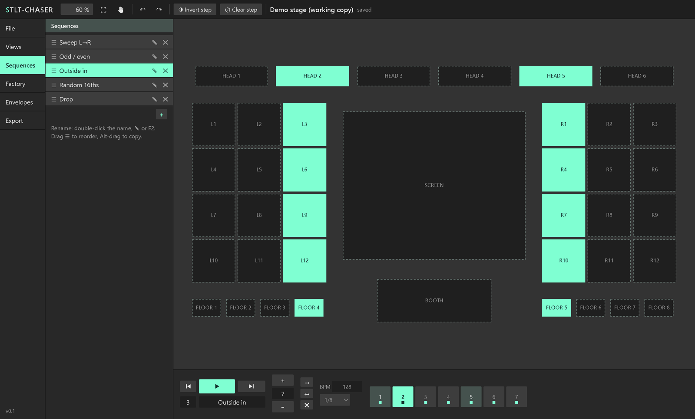
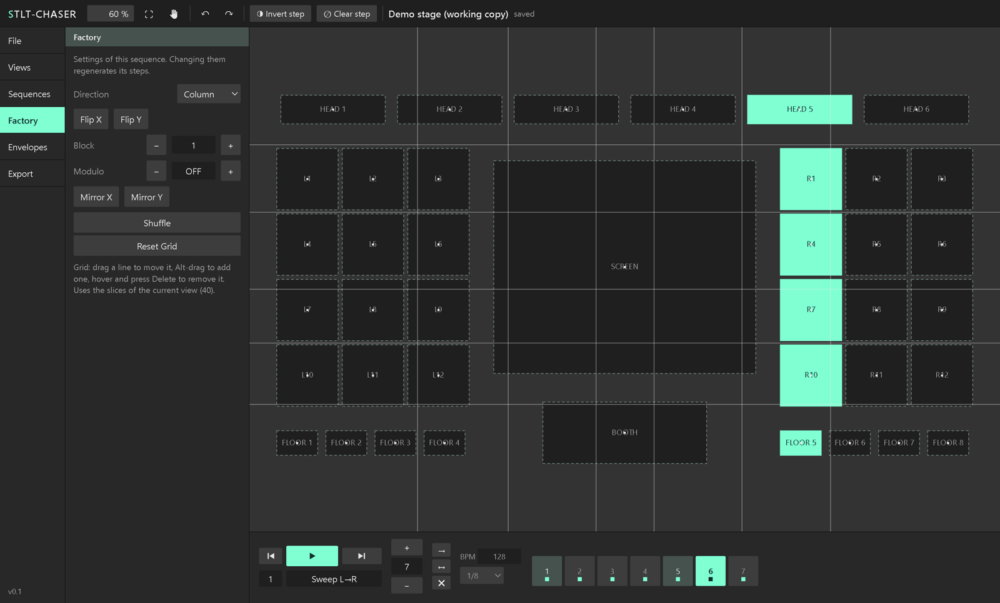

# STLT-CHASER

Screen bumps, chases, wipes, delays and outlines across the slices of **Resolume Arena's Advanced Output**.
STLT-CHASER is a free, open-source toolkit made of:

- **an editor** (Windows and macOS) where you draw step sequences on your stage, slice by slice, and
- **three FFGL effects** for Resolume that play them live: **STLT-CHASER**, **STLT-WIPER** and **STLT-OUTLINER**.

Whatever you change in the editor reaches Resolume within half a second, even while the effects are running.



> 🇮🇹 Guida completa in italiano: [docs/GUIDA.md](docs/GUIDA.md)

STLT-CHASER is an independent project. It is not affiliated with or endorsed by Resolume or by the makers of any other product.

## Install

1. Download the latest release from the **Releases** page:
   - Windows: `STLT-CHASER-<version>-Windows-Setup.exe`
   - macOS (Apple Silicon and Intel): `STLT-CHASER-<version>-macOS.dmg`
2. **Windows**: run the setup. The installer is not code-signed, so Windows may show *"Windows protected your PC"*: click *More info → Run anyway*.
   **macOS**: open the dmg and drag STLT-CHASER into Applications. The app is not notarised: the first time, right-click it and choose *Open*.
3. On first launch the editor offers to install the plugins into Resolume (`Documents/Resolume Arena/Extra Effects/STLT-CHASER`). Close Resolume first. You can do it again any time from **File → Install / update plugins**.
4. Start Resolume: the effects STLT-CHASER, STLT-WIPER and STLT-OUTLINER appear in the effects list.

Requirements: Resolume Arena or Avenue 7.4 or later (tested with Arena 7.23 on Windows); Windows 10/11 64-bit or macOS 10.15 or later.

## Quick start

1. Set up your stage in Resolume's **Advanced Output** and click *Save & Close*.
2. Open the STLT-CHASER editor: it loads your slices automatically.
3. Pick a step at the bottom and click the slices that should light up on it. Everything saves as you go.
4. In Resolume add the **STLT-CHASER** effect to a layer, choose the *Sequence*, and animate *Step* with BPM sync.

## The effects

**STLT-CHASER** – lights slices step by step through a sequence.
*Driver* (Chaser, or None to keep every slice lit), *Sequence*, *Step* (0→1 runs through the sequence; animate it with BPM sync, the timeline or FFT), *Scaling* (Mask, Fill, Stretch), *View*, *Echoes*, *Envelope* or *Sustain / Release*.
Its **Delayer** module shows each slice as the content was some time ago, with the delay spread over the stage by a *Delay Sequence* (first step: no delay, last step: the full delay), in frames, seconds or beats.
Its **Wiper** module runs gradient wipes through the slices of a second sequence (*Wipe Sequence*, *Wipe Step* and the same controls as STLT-WIPER), showing the video or a *Solid Color*. Chase and wipes add up: a slice shows wherever either lights it, so one STLT-CHASER on the composition does both.
Its **Outliner** module draws outlines on top with the same controls as STLT-OUTLINER. *Outline Target*: *Lit Slices* follows the chase and the wipes, *All Slices* outlines the whole view; *Outlines Only* hides the video and keeps just the outlines.

**STLT-WIPER** – each step sends a gradient wipe through its slices. Vertical slices wipe bottom to top, horizontal ones away from the centre of the stage. *Length*, *Overlap*, *Loops*, *Flip Direction*, *Odd/Even*, *Swap Directions*, *Envelope*. *Source*: the video or a *Solid Color*; *Show Original* draws the wipes over what comes in instead of on a transparent background.

**STLT-OUTLINER** – outlines drawn inside every slice, so they never bleed into neighbours. Static with an inward *Feather*, or animated tapered lines running around the edges (*Phase*, *Fan*, *Randomise*, *Length*, *Count*, *Flip Direction*, *Odd/Even*). *Show Original* draws them over the incoming video; *Lit Slices Only* outlines just the slices an STLT-CHASER above it is lighting.

Effects in Resolume work in a chain: each one only sees what the one above lets through.
- **Chase, wipes and outlines on the whole composition**: one STLT-CHASER on the composition with its Wiper and Outliner modules on. Layers and clips can change freely underneath.
- **STLT-CHASER → STLT-WIPER** (Solid Color, Show Original on): coloured wipes over the chase.
- **STLT-CHASER → STLT-OUTLINER** (*Lit Slices Only*): outlines on the lit slices.
- *Scaling*: use **Fill** or **Stretch** for full-frame clips, **Mask** for content that is already laid out over the stage (another STLT effect's output, a mapped layer, the composition).

## The editor

- **Canvas**: your slices as in Resolume. Click to toggle a slice in the current step, drag across slices to flip them, box-select (Shift: on, Ctrl: off, Alt: hide in view), zoom with the wheel, pan with Space.
- **Sequencer**: 1 to 1024 steps per sequence, unlimited sequences. Drag a step onto another to copy it; drag and hold to copy it to every n-th step. Repeat, ping-pong and clear buttons, preview playback with BPM.
- **Views**: named groups of slices, used by the effects to limit which slices they touch.
- **Factory**: generates sequences from a grid laid over the slice centres (horizontal, vertical, row, column, random; flip, block, modulo, mirror, shuffle). Drag the grid lines to adjust it.

  

- **Envelopes**: draw opacity curves with Bézier handles, shared by all projects.
- **Export**: input and output maps as PNG test patterns, with names, positions and sizes.

The working document lives in `%APPDATA%\Stilletchaser` on Windows and `~/Library/Application Support/Stilletchaser` on macOS; see [docs/FORMAT.md](docs/FORMAT.md).

## Building from source

Clone with the FFGL SDK submodule:

```
git clone --recursive https://github.com/alfonsostillet/stlt-chaser.git
```

**Plugins** (CMake 3.15+; Visual Studio 2022 on Windows, Xcode command line tools on macOS):

```
cmake -S plugin -B plugin/build
cmake --build plugin/build --config Release
cmake --install plugin/build --prefix plugin/dist --config Release
```

On macOS this builds universal (arm64 + x86_64) `.bundle` files.

**Editor** (Node.js 22+):

```
cd editor
npm install
npm test
npm start            # run from source
npm run dist:win     # or dist:mac – installer in editor/release, plugins from plugin/dist included
```

Releases are built by GitHub Actions ([.github/workflows/release.yml](.github/workflows/release.yml)) when a `v*` tag is pushed.

More on how it works: [docs/DESIGN.md](docs/DESIGN.md).

## License

Copyright © 2026 STILLET.

STLT-CHASER is free software: you can redistribute it and/or modify it under the terms of the **GNU General Public License v3.0**, see [LICENSE](LICENSE).
It uses the FFGL SDK, GLEW, JSON for Modern C++ and Electron under their own licenses, listed in [THIRD_PARTY_NOTICES.md](THIRD_PARTY_NOTICES.md).
